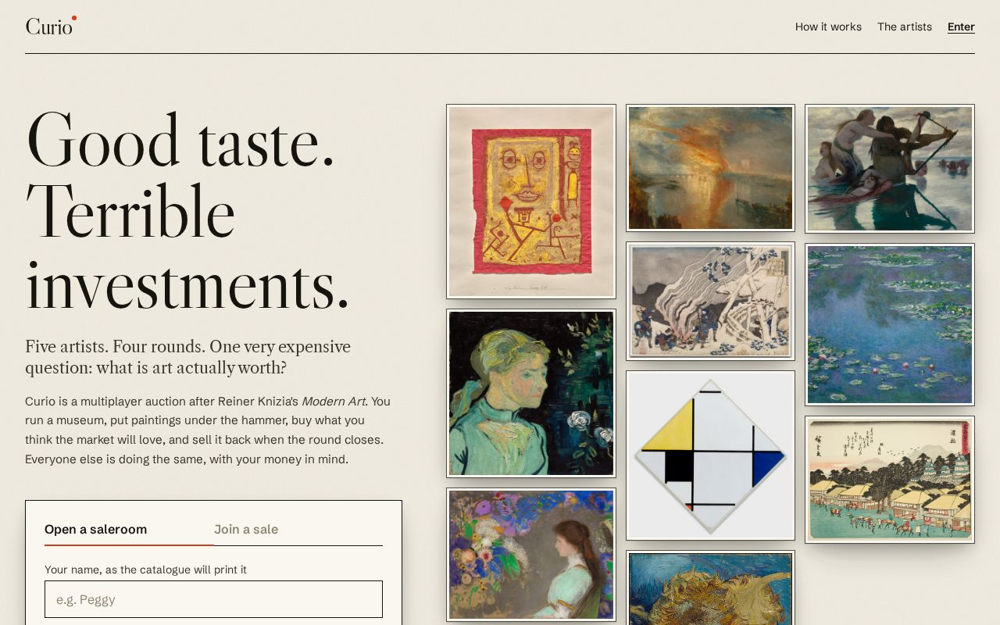

<div align="center">



# Curio

**Good taste. Terrible investments.**

[Play it](https://curio.futile.studio) · [Futile Studio](https://futile.studio)

[](https://curio.futile.studio)


</div>

> **Futile Studio** · Games, auction game · Live since Nov 2026

## Overview

Curio is a multiplayer art auction for 3 to 5 players, after Reiner Knizia's *Modern Art*. You run a museum, put paintings under the hammer, buy what you think the market will love, and sell it back to the bank when the round closes. Everyone else is doing the same, with your money in mind.

Every card is a real public-domain painting from the open-access collections of The Metropolitan Museum of Art, The Cleveland Museum of Art and the Art Institute of Chicago. In the game each work hangs under one of five invented artists. The real title, maker, museum and licence are always shown in the catalogue entry.

## How to play

- Open a saleroom and share the four-letter code or link. Phones work as private paddles.
- Open `/r/CODE/table` on a laptop or TV for a shared display with no private information.
- Five auction types: open, once around, hidden (sealed bids), fixed price and double.
- A round ends when the fifth painting by one artist comes up. Market values add up across rounds.
- Full rules are on the landing page and in the game (Rules).

## Running it locally

Node 20+.

```sh
npm install
npm run dev        # API on :4431, Vite on :5173
npm test           # rules engine + artwork normalisation
npm run typecheck
npm run build && npm start   # production on :4431
npx tsx scripts/soak.ts http://localhost:4431 6   # real Socket.IO clients play 6 full games
npm run ingest     # rebuild server/art/catalog.json from the museum APIs
```

State is saved as JSON under `DATA_DIR` (default `./data`). Rooms survive a restart, and museum images are cached there too.

## Configuration

- `PORT`: HTTP and Socket.IO port, default `4431`.
- `DATA_DIR`: where rooms and the image cache live, default `./data`.

## How it is built

- **Rules engine** (`shared/engine.ts`): pure and deterministic. `apply(game, action)` returns a new state or throws `RuleError`. It covers all five auction types, the double-auction fallback, round end on the fifth painting, cumulative market values, artist tie order, and a `view()` that strips other hands, sealed bids and the deck.
- **Multiplayer** (`server/rooms.ts`, `server/index.ts`): Express + Socket.IO. The server is the only source of truth. It stamps the seat on every action, rejects anything out of turn, de-duplicates retried requests by nonce, runs the turn clock, migrates the host after a disconnect, and persists rooms to disk.
- **Artwork** (`server/art/`): one `ArtworkProvider` per museum, normalised to one `Artwork` model. Ingestion keeps only public-domain / CC0 records with working images, removes duplicates, and verifies each image. Images are proxied and cached server-side from an allowlist of museum hosts.
- **UI** (`src/`): React 19, Tailwind 4, Motion. Sounds are synthesised with Web Audio. See [DESIGN.md](DESIGN.md) for the design system.

## Deployment

The `Dockerfile` runs the tests, builds the client and serves everything with `tsx server/index.ts` on port 4431, with `/data` as a volume and a `/health` check. A GitHub Actions workflow pushes the image to `ghcr.io/mayurjivani/curio` on every push to `main`. `deploy/` holds the compose file and Caddy block for my own server.

## Rules notes

Card mix per artist (12/13/14/15/16), deal sizes and market values (30/20/10) follow the published game. Where the rulebook is ambiguous, Curio chooses:

- A double auction's second painting can come from the next player who has one. If nobody adds one, the auctioneer keeps the double for free and play passes on.
- A player with no cards is skipped.
- A round with no cards left anywhere ends without a fifth painting.

Not affiliated with Reiner Knizia or any publisher of *Modern Art*.

## Licence

No licence file yet, all rights reserved. The paintings are public domain / CC0 works from the museums named above.

---

<p align="center">
  <a href="https://futile.studio"></a>
  <br>
  <sub>Built by <a href="https://github.com/MayurJivani">Mayur Jivani</a>. Everything is futile. Do it anyway.</sub>
</p>
